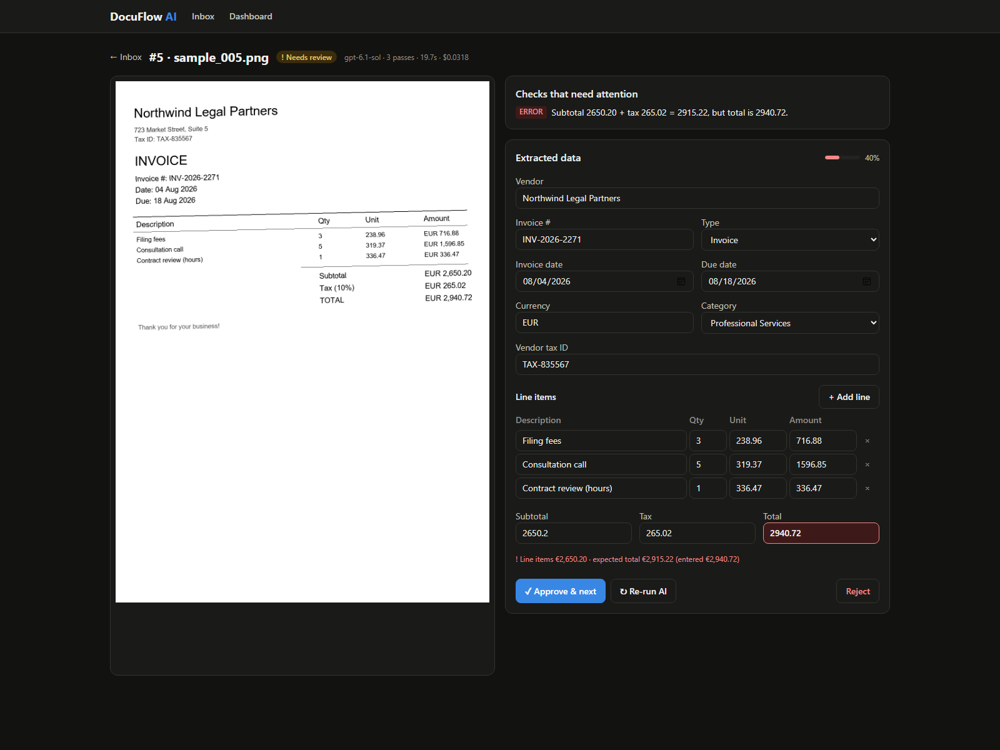
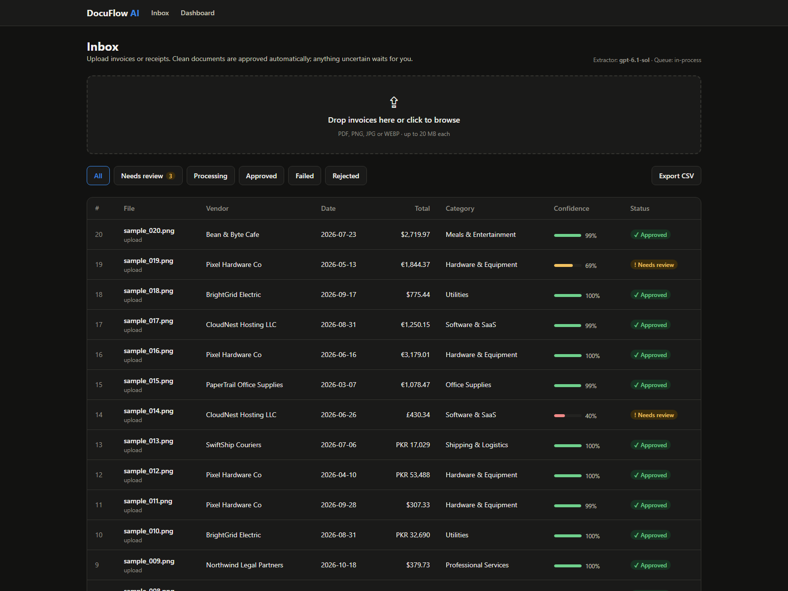
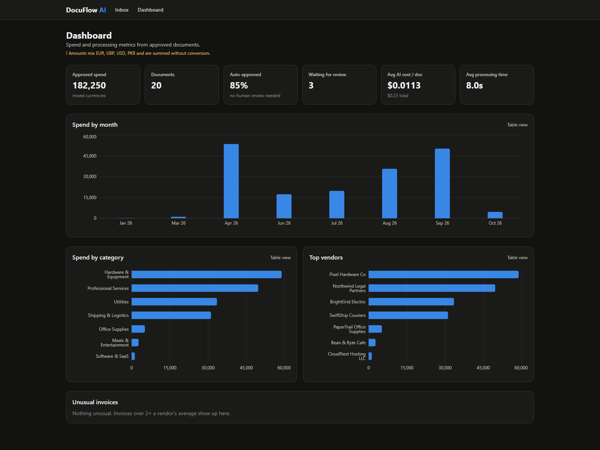

# DocuFlow AI: invoice and receipt processing agent

Upload invoices and receipts (PDFs or phone photos). An AI model (Claude or OpenAI GPT, your choice) reads each one, the data is checked automatically, and the agent re-reads the document when the numbers don't add up. Clean documents are approved on their own; uncertain ones wait in a review screen. Approved data goes to Google Sheets, CSV, or any n8n flow (QuickBooks, Xero, Airtable and so on).



| Inbox | Dashboard |
|---|---|
|  |  |

**Benchmark (20 invoices, gpt-6.1-sol):** 100% field accuracy · 85% auto-approved · $0.011 and 7.3 s per invoice · 2/2 planted math errors caught. See [results](docs/screenshots/5-results.png) and [architecture](docs/screenshots/4-architecture.png).

```
Gmail / Drive (n8n) ─┐
Web upload ──────────┼─► FastAPI ─► queue ─► Agent pipeline ─► Postgres ─► Review UI / Dashboard
                     │                       1 preprocess (deskew, contrast, PDF text layer)
                     │                       2 extract (Claude vision, or text for digital PDFs)
                     │                       3 validate (math, dates, currency, duplicates)
                     │                       4 self-correct (re-ask with the exact errors, up to 2x)
                     │                       5 categorize (learned vendor default > model > keywords)
                     │                       6 score confidence → auto-approve or human review
                     └──────────────────────────────────────────► Exports: Sheets · n8n webhook · CSV
```

## Features

- **Vision extraction** with Claude structured outputs (validated by a Pydantic schema): vendor, invoice number, dates, currency, subtotal, tax, total, line items, category, and per-field confidence
- **Self-correcting agent loop**: when a check fails (for example, line items don't add up to the total), the model gets its previous answer plus the exact errors and re-reads the page. A digital PDF that fails in cheap text mode is retried with vision.
- **Validation rules**: line-item sum, subtotal + tax = total, qty × unit price, date sanity, due date after issue date, ISO currency, duplicate detection (by file hash, and by vendor + invoice number)
- **Confidence routing**: errors cap confidence at 40% and each warning costs 10%. Auto-approval needs ≥ 90% (configurable) and no errors.
- **Review UI**: the document on the left and editable fields on the right; flagged fields are highlighted; a live math check; Ctrl+Enter approves and opens the next document
- **Learns from corrections**: every edit is stored, and a vendor's category is remembered for next time
- **Dashboard**: spend by month, category and vendor; auto-approve rate; AI cost and time per document; unusual invoices (more than 2× the vendor's usual amount)
- **Cost tracking**: tokens and USD cost per document
- **Integrations**: n8n Gmail and Drive intake workflows, Google Sheets export, a generic n8n export webhook, CSV
- **Eval harness**: field-level accuracy, line-item F1, auto-approve rate, and cost and time per document
- **Offline demo mode** (`EXTRACTOR=mock`) with 20 generated sample invoices, so it runs without an API key

## Quick start (local, no Docker)

Needs Python 3.12+ and Node 20+.

```bash
# Backend
cd backend
python -m venv .venv
.venv\Scripts\activate            # macOS/Linux: source .venv/bin/activate
pip install -r requirements-dev.txt
copy .env.example .env            # macOS/Linux: cp .env.example .env
uvicorn app.main:app --reload --port 8000

# Frontend (second terminal)
cd frontend
npm install
npm run dev                       # http://localhost:3000
```

**Demo data:** `python scripts/make_samples.py --count 20` writes synthetic invoices to `samples/invoices/`. Drag them into the Inbox. In mock mode they're "extracted" from their ground truth, so you can demo the whole flow for free. Some samples are rotated, blurred or tinted, and a few contain deliberate math errors so they land in review.

**Real AI extraction:** choose a provider in `backend/.env`, then restart the API:

| Provider | Settings |
|---|---|
| Anthropic Claude | `EXTRACTOR=claude`, `ANTHROPIC_API_KEY=sk-ant-...`, optional `LLM_MODEL` (default `claude-opus-5-5`) |
| OpenAI GPT | `EXTRACTOR=openai`, `OPENAI_API_KEY=sk-...`, optional `OPENAI_MODEL` (default `gpt-6.1-sol`) |

Both providers use the same prompt, schema, validation and self-correction loop, so their eval results are directly comparable.

## Full stack with Docker

```bash
cp backend/.env.example backend/.env    # edit it
docker compose up --build
```

UI at http://localhost:3000, API docs at http://localhost:8000/docs, n8n at http://localhost:5678. Compose runs Postgres, Redis, the API, 2 workers, the frontend and n8n.

## n8n workflows

Import them from `n8n/workflows/` (n8n → Workflows → Import from file):

| Workflow | What it does |
|---|---|
| `gmail-intake.json` | Polls Gmail for emails with invoice attachments and posts them to `/api/webhooks/ingest`, then labels the email. Create a `docuflow-processed` label and select it in the last node. |
| `drive-intake.json` | Watches a Google Drive folder; new files go to DocuFlow. Paste your folder URL in the trigger. |
| `export-to-sheets.json` | Receives approved invoices (set `N8N_EXPORT_WEBHOOK_URL=http://n8n:5678/webhook/docuflow-approved`) and appends them to a Google Sheet. Swap the last node for QuickBooks, Xero or Airtable. |

Set `WEBHOOK_SECRET` in `backend/.env`. n8n sends it as `X-Webhook-Secret` (the env var `DOCUFLOW_WEBHOOK_SECRET` must hold the same value in n8n).

## Google Sheets export (direct, without n8n)

1. Create a Google Cloud service account, enable the Sheets API, and download its JSON key.
2. Share your sheet with the service account's email address.
3. Set `GOOGLE_SERVICE_ACCOUNT_FILE` and `GOOGLE_SHEET_ID` in `backend/.env`.

## Measuring accuracy

```bash
cd backend
.venv\Scripts\python ..\eval\run_eval.py                       # samples/ dataset
.venv\Scripts\python ..\eval\run_eval.py --dataset ..\eval\dataset --limit 20
```

To compare providers on the same documents, run it once per provider:

```bash
set EXTRACTOR=claude& .venv\Scripts\python ..\eval\run_eval.py
set EXTRACTOR=openai& .venv\Scripts\python ..\eval\run_eval.py
```

It prints a Markdown table you can paste into your portfolio and saves per-document results in `eval/results/`. For honest numbers, use **real** invoices: put files in `eval/dataset/invoices/` and hand-labelled JSON (same shape as `samples/ground_truth/*.json`) in `eval/dataset/ground_truth/`. Public sets such as SROIE and CORD work well. With `EXTRACTOR=claude` every run calls the API and costs money.

## Configuration

All settings are in `backend/.env` (see `.env.example`). Key ones:

| Setting | Default | Notes |
|---|---|---|
| `EXTRACTOR` | `claude` | `claude`, `openai`, or `mock` (offline demo) |
| `LLM_MODEL` | `claude-opus-5-5` | any Claude model with vision |
| `OPENAI_MODEL` | `gpt-6.1-sol` | any OpenAI model with vision |
| `OPENAI_REASONING_EFFORT` | model default | `none` … `max` |
| `LLM_EFFORT` | `medium` | `low` is cheaper/faster; try it on your eval set |
| `LLM_FALLBACKS` | `true` | server-side fallback model if a request is declined |
| `MAX_CORRECTION_ATTEMPTS` | `2` | self-correction passes |
| `AUTO_APPROVE_THRESHOLD` | `0.90` | |
| `USE_PDF_TEXT_MODE` | `true` | digital PDFs sent as text (cheaper); scans use vision |
| `REDIS_URL` | empty | empty = in-process background thread |

## Tests

```bash
cd backend
.venv\Scripts\python -m pytest
```

These cover the validation rules, the self-correction loop, the Claude request shape (with a fake client), preprocessing, and the full API flow (upload → auto-approve or review → correct → learn the category → export).

## Project layout

```
backend/app/
  main.py, api.py          FastAPI app and routes
  config.py, db.py, models.py, schemas.py
  worker.py                queue (RQ/Redis or in-process)
  pipeline/                preprocess · extract_llm (Claude) · extract_openai · extract_mock · validate · categorize · orchestrator
  integrations/exporters.py Google Sheets · n8n webhook · CSV
frontend/                  Next.js 15 + Tailwind + Recharts (Inbox, Review, Dashboard)
n8n/workflows/             importable n8n workflows
eval/run_eval.py           accuracy harness
scripts/make_samples.py    synthetic invoice generator
```

## Hosted read-only demo

The public demo is the frontend alone, built with `NEXT_PUBLIC_DEMO_MODE=1`. It reads a static snapshot of a real run from `frontend/public/demo/`, so it needs no backend and no API key, and visitors can't spend credits. Review and approve work in the browser but aren't saved; uploads are off.

To refresh the snapshot, process documents locally with the API running, then:

```bash
backend\.venv\Scripts\python scripts\export_demo.py
```

Deploy `frontend/` to Vercel (root directory `frontend`, env var `NEXT_PUBLIC_DEMO_MODE=1`).

## Before putting it online

- Add authentication. The API is open and the demo has no logins.
- Use Postgres instead of SQLite, plus `REDIS_URL` with workers (Docker Compose does both).
- Decide on file retention for clients' documents, and keep `.env` out of git.
